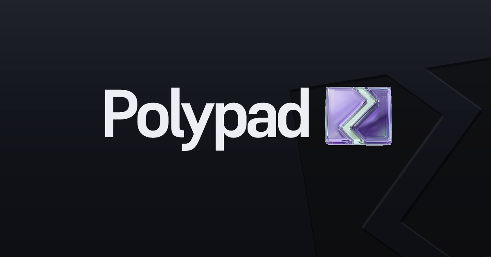

<p align="center">
  <a href="https://polypad.trade"></a>
</p>

<p align="center">
  <b>Memecoins on live Polymarket odds, on Robinhood Chain.</b>
</p>

<p align="center">
  <a href="https://github.com/polypadteam/Polypad-core/actions/workflows/test.yml"></a>
  <a href="LICENSE"></a>
  
  <a href="https://book.getfoundry.sh"></a>
  
  <a href="deployments"></a>
  
</p>

---

# Polypad Core

Smart contracts for [Polypad](https://polypad.trade): memecoins on Robinhood Chain
(live, v15) and Solana (in development, unaudited), each paired with a live
Polymarket outcome.

A Polypad coin launches on a bonding curve like any memecoin, but its curve is
priced in **shares of a real Polymarket outcome** instead of ETH. Buying pushes
the coin up the curve; the market's odds move the value of every share on it.
When the market resolves, each share pays $1 or $0, and the coin with it.

## How it fits together

```
user USDG ──Router──> PExchange mints pToken (1 pToken = 1 real Polymarket share, held by the desk)
                          │
                          └──> BondingCurve (coin / pToken) ──> coins to the user
```

| Contract | Role |
| --- | --- |
| `LaunchFactory` | Launches a coin: deploys the `Coin` (1B supply) and its `BondingCurve` |
| `BondingCurve` | Constant-product curve over a virtual reserve; trades the coin against the market's pToken; fees fixed at launch (1.4% on the curve, 1% in the pool, half to the creator side) — see [docs/FEES.md](docs/FEES.md) |
| `PToken` | One per Polymarket outcome: a 1:1 claim on a real share |
| `PExchange` | USDG ⇄ pToken at a verified price; holds the float; tracks unbacked risk per market and in total; meters payouts of settled markets per hour |
| `PriceOracle` | Verifies signed quotes, and holds each market's pause and settlement |
| `Router` | One-transaction USDG buys and sells, and sales of coins for shares (`sellForShares`); emits one `Swap` per trade |
| `Graduator` | Moves a sold-out curve into a Uniswap v4 pool it owns forever (locked liquidity); the pools' only hook |
| `FeeVault` | Receives the creator side of every fee: the creator's claimable balance, and an opt-in dividend streamed to the coin's holders |

### Prices

- **Signed quotes.** Polypad's pricer reads the live Polymarket order book and
  signs a price for one trade, valid for seconds. The quote rides in the user's
  own transaction and `PriceOracle.verify` checks it. Prices run from 0.1¢ to
  99.9¢, the range Polymarket itself trades in.
- **No posted prices.** A one-step trade at a posted on-chain price can be
  raced by anyone who sees Polymarket move first, so every mint and sale at a
  quote is priced at the moment it happens. `Router.sellForShares` and trades
  on a settled market need no quote.
- **Settlement.** The keeper records each market's payout from Polymarket's
  on-chain result; it takes effect an hour later (`SETTLE_DELAY`), and the owner
  can cancel a wrong one meanwhile, so one hot key cannot settle a market at $1
  and redeem the float.
- **$1 payouts mint at once.** While a recorded $1 payout waits out
  `SETTLE_DELAY`, buys mint at $1 with no quote: a share sold at $1 costs the
  float nothing whatever the outcome. Those shares never count as hedging for
  shares minted at a quote, in a backing report or when shares are burned.
- **Backing reports (v15).** The desk reports the shares it holds together with
  the pToken supply it read them at; a report is held to the lowest supply
  since that read, so a stale report can never take risk off shares minted
  after it.

### Safety

- Every pToken minted is matched by a real Polymarket share the desk buys.
  Unbacked risk is tracked per market and in total (`unbackedRisk`,
  `totalRisk`) with owner-set caps.
- Payouts of settled markets are metered per hour: the larger of $100,000 and
  50% of the float as the hour began. The part over it is held at its price
  and paid an hour later; the owner can cancel it meanwhile (the pToken goes
  back). Sales at a quote are metered the same way only while the owner turns
  `meterSales` on. The keeper can halt the exchange (mints, redeems, releases
  and queue payments), only the owner resumes it.
- A new signer takes effect only after 12 hours, a new bridge address after 2
  days; revoking the signer is immediate.
- `rescue` can never move the float or a pToken.
- Selling always works. Buys pause from a market's end date until it resolves.
  After resolution, pTokens are worth the market's payout: a winning one keeps
  trading both ways at $1, a losing one is worth $0 and can only be sold.

## Integrating

See [docs/INTEGRATION.md](docs/INTEGRATION.md) for events, pricing, the swap API
and plain on-chain trading. ABIs are in [`abi/`](abi) (JSON, and TypeScript in
`abi/index.ts`). Deployed addresses are in [`deployments/`](deployments).

## Solana (unaudited, devnet only)

[`solana/`](solana) holds the Solana port: two Anchor programs that mirror the
EVM contracts as closely as the chain allows, with USDC in place of USDG and
Meteora's Dynamic Bonding Curve and DAMM v2 in place of `BondingCurve` and
Uniswap v4.

| Program | Mirrors | Devnet address |
| --- | --- | --- |
| `polypad_exchange` | `PExchange`, `PriceOracle`, `PToken` (ed25519-signed quotes) | `3SzMv182JofB9Li4xjhqT5s283kwv8TbTgJWych6hDAd` |
| `polypad_launch` | `LaunchFactory`, `Graduator`, `FeeVault` (Meteora DBC → DAMM v2, LP locked) | `GDe9PRUW6Tq2McNSLTfXMETk4PgjHhyCYm3JvneKxLzn` |

**Not audited and not on mainnet.** Do not use with real funds. Differences
from the EVM contracts, and why, are in
[`solana/docs/EVM-PORT-SPEC.md`](solana/docs/EVM-PORT-SPEC.md); the Meteora
integration is in [`solana/docs/METEORA.md`](solana/docs/METEORA.md).

```sh
cd solana
anchor build --ignore-keys
bash programs/polypad_launch/tests/fixtures/fetch.sh   # Meteora mainnet binaries for the tests
cargo test
```

Requires Anchor 1.2.1, Agave 4.3.0, Rust 1.97. The tests run the programs in
LiteSVM against Meteora's mainnet binaries, plus a stateful fuzz of the
exchange's accounting (`PX_FUZZ_SEED`, `RUNS`, `STEPS`).

## Build and test

```sh
git clone --recurse-submodules git@github.com:polypadteam/Polypad-core.git
cd Polypad-core
forge build
forge test
```

Requires [Foundry](https://book.getfoundry.sh). Solidity 0.8.28; optimizer at
1,000,000 runs, except `PExchange` at 2,000 runs to fit the 24 KB size limit.
The deployed contracts verify with `--compilation-profile exchange`.

## License

The contracts in `src/` and the Solana programs' sources in
`solana/programs/*/src/` are licensed under the Business Source License 1.1
(see [LICENSE](LICENSE)). ABIs, IDLs, docs, tests and scripts are MIT (see
[LICENSE-MIT](LICENSE-MIT)).
